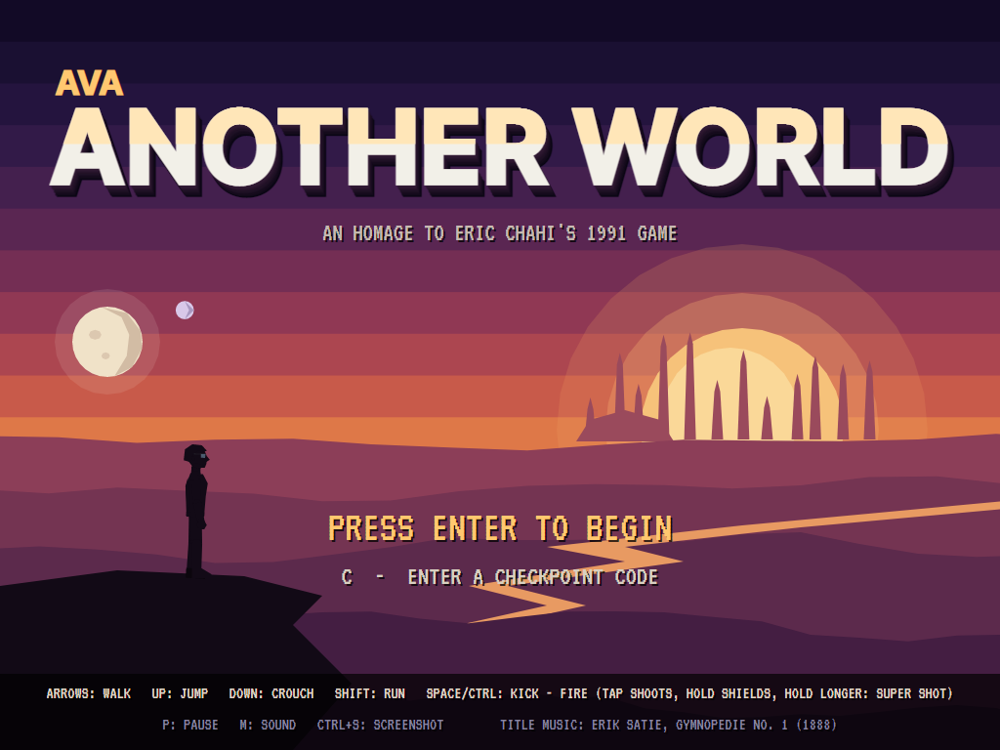
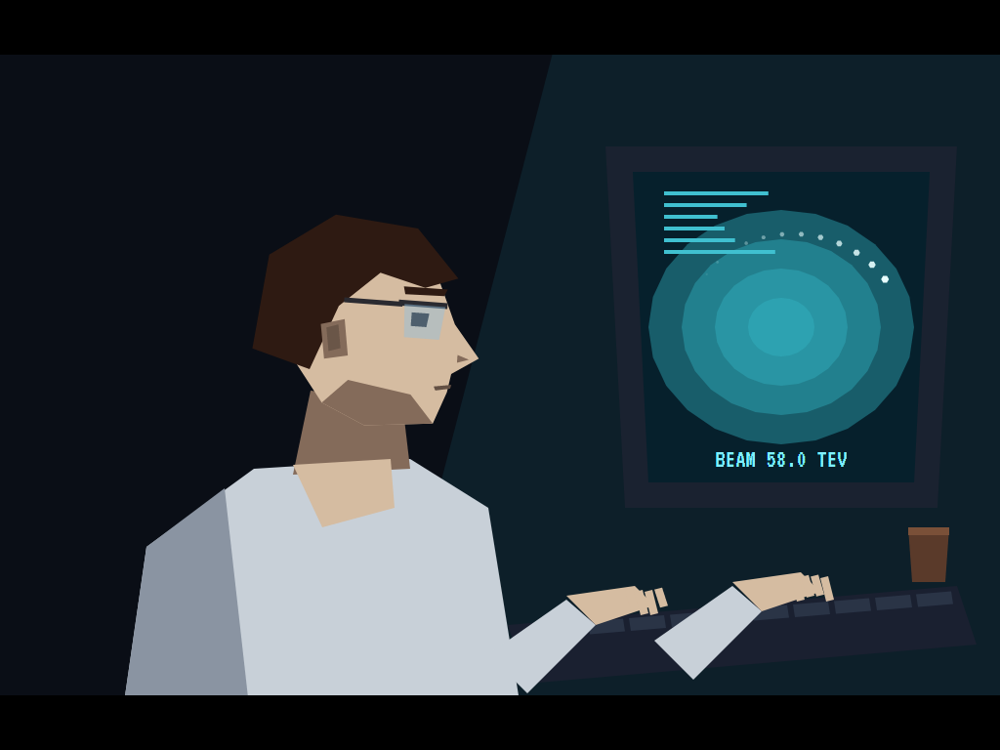
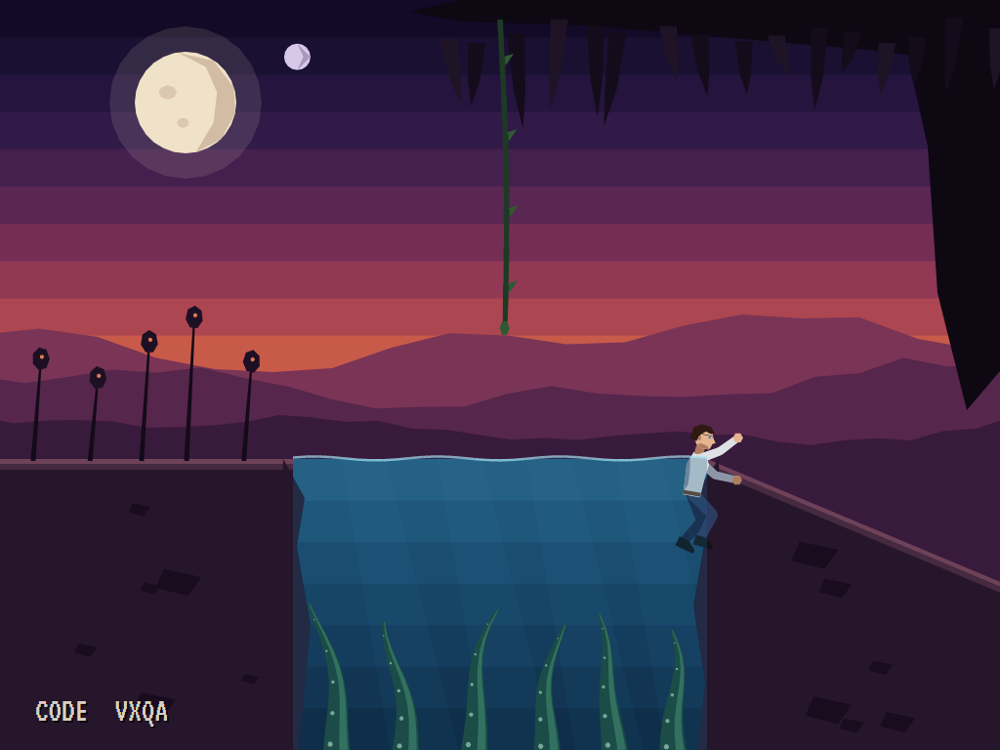
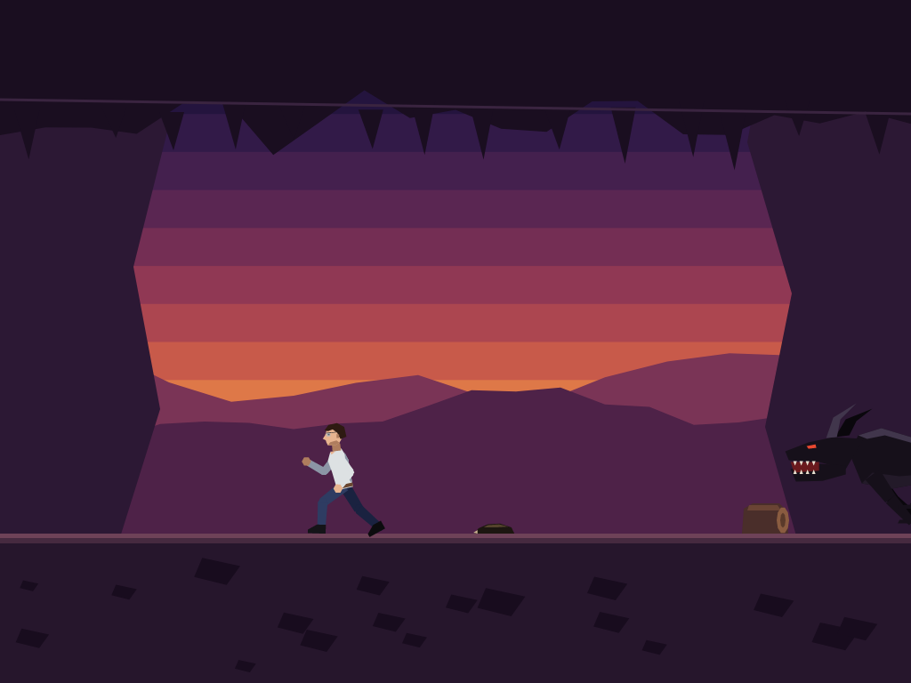
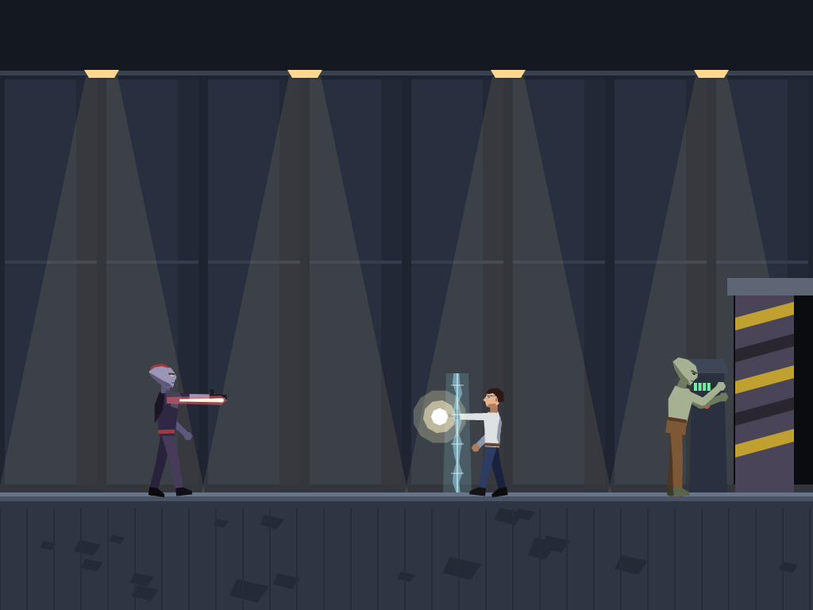
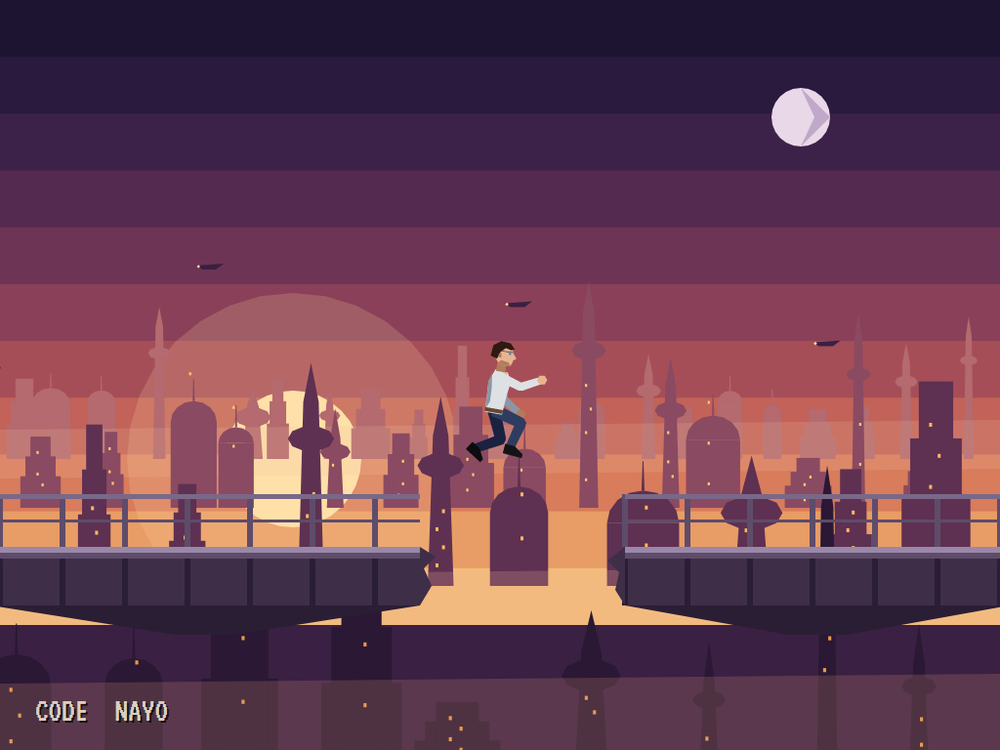
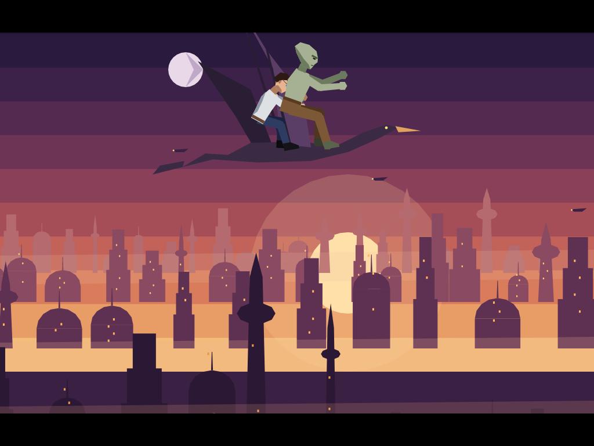

# AVA Another World

[](https://github.com/Harlock123/AVAAnotherWorld/actions/workflows/build.yml)

A cinematic escape in the style of Éric Chahi's 1991 game **Another World** (*Out of This World* in North America),
built with .NET 10 and Avalonia UI. On a stormy night, a young physicist, Theo Marsh, runs one last experiment at the
Halvard Institute. Lightning strikes the building, the beam runs wild, and he is thrown out of our world and into a
pool under an alien sky. Everything is drawn as flat-shaded polygons: the rooms, the people, the cut-scenes, even the
moons.

## Features

- **Nine sections**, each a checkpoint with a four-letter code:
  1. **The pool.** Theo arrives underwater, and tentacles rise from the bottom. Swim up and out before they reach
     him, then kick the leeches crawling at him and run under the one that drops from the roof.
  2. **The beast.** At the cliff edge something climbs up after him. Run back the way he came, leap the log, and
     leap from the very edge of the bank to catch the vine over the pool.
  3. **The cage.** Captured, he hangs in a cage over a hall with an alien prisoner. Rock it with the swing until the
     chain snaps, and time it so the cage comes down on the guard pacing below.
  4. **The cells.** With the guard's pistol, fight along the cells. The friend, Oru, works the door's panel while
     guards come from behind.
  5. **The shaft.** Down the ledges: some drops are short and safe, others kill. At the bottom, acid drips from the
     roof, and a guard waits behind a shield.
  6. **The sunken way.** Swim the flooded tunnels with one breath, and find the air pocket on the way.
  7. **The power halls.** Slip through the barriers between their pulses, then shoot the switch that turns off the
     one that never stops.
  8. **The bridge.** Over the alien city: leap the broken span at a run, and fight guards from both sides.
  9. **The tower.** The warden, behind his shield, charging super shots of his own.
- **The pistol, three ways:** tap fire to shoot. Hold it a moment and let go: a shield wall goes up in front.
  Hold it longer, until it glows, and let go: a super shot that breaks through shields. Guards raise shields too,
  and a quick one raises one as your shot comes. A crouch ducks a guard's shot.
- **One touch is death**, and Theo is back at the checkpoint at once. There is no HUD: just a section's code in the
  corner when it is first reached (and on the pause screen). Put a code in on the title screen to return there.
- **Cut-scenes** in the same polygons: the storm and the experiment, the capture, the cage's fall and the friend,
  the friend again on the bridge, and the end. Space or Enter skips one.
- **Rotoscope-like animation:** each person is a skeleton of polygon limbs, the far arm and leg in shadow. Poses
  are keyframes, blended smoothly from one to the next: the walk, the run, the leap, the swim, the turn, the kick,
  the aim, the collapse. Shot, a body flashes white with its bones showing.
- **The attract mode** shows the computer player in the opening two sections. It knows each section's way through.
  Facing a guard, it raises a shield and then charges a super shot through his. Where timing matters (the cage,
  the drips, the barriers), it plays the next moment out on a copy of the world first and waits until it's safe.
- **Sound:** rain and thunder, wind, caves, machinery; laser shots, the charge hum, shields, the beast's roar, the
  aliens' gibberish; stings of its own, and Erik Satie's *Gymnopédie No. 1* on the title screen.

## Screenshots

| The title | The night of the experiment | Arrival in the pool |
|:---------:|:---------------------------:|:-------------------:|
|  |  |  |

| The beast | A gunfight with shields | The alien city |
|:---------:|:-----------------------:|:--------------:|
|  |  |  |

| The end |
|:-------:|
|  |

The screenshots are made by the tests, which play the game in a real (headless) window; see [Tests](#tests).

## Download and run

Ready-to-run builds for Windows, macOS and Linux, on both Intel/AMD and ARM, are on the
[Releases page](https://github.com/Harlock123/AVAAnotherWorld/releases/tag/latest). **Latest build** is
rebuilt on every push to `main`. Each download is one self-contained executable: no .NET install is
needed.

| Platform | Archive |
|---|---|
| Windows | `AVAAnotherWorld-win-x64.zip`, `AVAAnotherWorld-win-x86.zip`, `AVAAnotherWorld-win-arm64.zip` |
| macOS | `AVAAnotherWorld-osx-arm64.tar.gz` (Apple silicon), `AVAAnotherWorld-osx-x64.tar.gz` (Intel) |
| Linux | `AVAAnotherWorld-linux-x64.tar.gz`, `AVAAnotherWorld-linux-arm64.tar.gz`, `AVAAnotherWorld-linux-arm.tar.gz` |

```bash
tar -xzf AVAAnotherWorld-linux-x64.tar.gz     # or linux-arm64, linux-arm, osx-arm64, osx-x64
./AVAAnotherWorld
```

On Windows, unzip and run `AVAAnotherWorld.exe`. On macOS, if Gatekeeper refuses to open it, run
`xattr -d com.apple.quarantine AVAAnotherWorld` once. Run with `--no-audio` for silence.

**Sound** comes through OpenAL Soft, built in for every platform. In a virtual machine the game
detects it and uses a larger audio buffer, so the sound doesn't break up.

**Gamepads** use SDL2, which is bundled for Windows, macOS and Intel/AMD Linux. ARM Linux builds need it
installed; without it the keyboard still works:

```bash
sudo apt install libsdl2-dev            # Debian / Ubuntu / Raspberry Pi OS
sudo pacman -S --needed sdl2-compat     # Arch / Omarchy
```

## Controls

| Action | Keyboard | Gamepad |
|---|---|---|
| Start | Enter or 1 | Start |
| Walk | Left/right arrows (or A/D) | Left stick / D-pad |
| Run | Shift with left or right | X, a shoulder button or the right trigger |
| Jump (moving: a leap; running: a long leap) | Up (or W) | Up |
| Crouch | Down (or S) | Down |
| Swim | The arrows: up is up, down is down | Stick / D-pad |
| Kick (no pistol yet) | Space or Ctrl | A or B |
| Shoot / shield / super shot | Tap / hold / hold longer Space or Ctrl | A or B |
| Rock the cage | Left and right, with the swing | Left and right |
| Enter a checkpoint code (title) | C or Tab, type the letters, Enter | Y, up/down to dial, A, Start |
| Skip a cut-scene | Space or Enter | A or Start |
| Pause | P or Esc | Start |
| Sound on/off | M | |
| Screenshot | Ctrl+S (to your Pictures folder) | |

The checkpoint codes are shown as each section is first reached.

## Tests

```bash
dotnet test AVAAnotherWorld.slnx
```

The game runs in fixed 60 Hz steps, so it plays the same at any frame rate. Everything that changes lives in
one world that can be copied. The tests check:

- **Moving:** walking and running speeds; turning round; a log stopping a walk and a running leap clearing it;
  a jump straight up and down; crouching; only a running leap clearing the broken bridge; short drops safe and long
  falls deadly; off the side of the screen into the next room.
- **The pistol:** a kick without it, squashing a leech; a tap shooting; a hold making a shield; a longer hold making
  a super shot; two shields a side at most, and shields fading.
- **Shields and guards:** a guard shooting a hero in the open, and his shield stopping the shots; a crouch ducking
  them; a guard's shield stopping a shot but a super shot breaking it; a quick guard shielding against a shot
  coming; shields barring the way; guards walking in; the warden's super shot breaking shields.
- **The sections:** the computer player solving each from its checkpoint; and each one's hazards: the tentacles,
  the dropping leech, the beast catching a walker, missing the vine, the cage swinging higher with the rocking and
  crushing the guard (or not), the door waiting for the friend, the acid drips, the breath running out and the air
  pocket, up in the water being up, the barriers and their switch, the warden.
- **Checkpoints and codes:** nine different codes, each bringing its section back; putting a code in on the title;
  the code entry; a death restarting the checkpoint at once.
- **The cut-scenes:** the experiment before the pool, with its rain and thunder; skipping; the shots in order; the
  capture, the cage's fall and the reunion between their sections; the ending, the end, and back to the title.
- **The game:** the computer player from the storm to the end without a death; holding right getting nowhere; the
  demonstration; pause; a copied world; the keys through the input handler into the world (Shift's release
  arriving as CapsLock too); every sound's file; music, stings and ambience each on their channel.

`tests/AVAAnotherWorld.Tests/PilotProbe.cs` reports how the computer player gets on, section by section
(`AW_PROBE=1`). It plays the whole game without a death in a little over two minutes of play.

The screenshot tests draw the real screen in a headless window. To refresh the README's pictures:

```bash
AW_SHOTS=$PWD/Images dotnet test tests/AVAAnotherWorld.Tests --filter ScreenshotTests
```

## Building

```bash
dotnet build AVAAnotherWorld.slnx
dotnet run --project src/AVAAnotherWorld
```

Needs the .NET 10 SDK. The sounds, ambience and music are made by `tools/make_sounds.py` (standard-library
Python, with the formant voice in `tools/speech.py` for the aliens' gibberish): `python3 tools/make_sounds.py`
rewrites `src/AVAAnotherWorld/Sounds`.

## Project structure

```
AVAAnotherWorld/
├── AVAAnotherWorld.slnx
├── src/AVAAnotherWorld/
│   ├── Engine/
│   │   ├── GameEngine.cs        # States, sections and checkpoints, cut-scenes, the demonstration
│   │   ├── Sim.cs               # The hero: walking, running, leaping, falling, swimming, the vine, the pistol
│   │   ├── Sim.Foes.cs          # Guards, the beast, leeches, bolts and shields, the cage, the hazards
│   │   ├── Sections.cs          # The nine sections, their rooms and codes
│   │   ├── Scenes.cs            # The cut-scenes, shot by shot
│   │   ├── World.cs             # Everything that changes, kept together so it can be copied
│   │   ├── Pilot.cs             # The computer player (the demonstration, and the tests)
│   │   ├── CodeEntry.cs         # Putting a checkpoint code in
│   │   ├── InputHandler.cs, ControllerManager.cs  # Keys and an SDL2 gamepad
│   │   └── SoundManager.cs      # Effects, ambience and music through OpenAL
│   ├── Audio/                   # The OpenAL engine (from the author's AVABand)
│   ├── Views/GameCanvas*.cs     # The polygon renderer: rooms, figures, cut-scenes, the title
│   └── Sounds/                  # The synthesised effects, ambience and music
├── tests/AVAAnotherWorld.Tests/ # Gameplay and screenshot tests
├── tools/make_sounds.py, tools/speech.py
└── Images/                      # Screenshots
```

## About and licence

AVA Another World © 2026 Lonnie Watson, under the [MIT License](LICENSE).

*Another World* (*Out of This World*) © 1991 Éric Chahi / Delphine Software; the names belong to their current
owners. AVA Another World is an independent, unofficial game in its style, an homage. Its story, characters,
scenes, graphics, sounds, music and code are its own; nothing is taken from the original game's program, script,
graphics, sound or music. It is not affiliated with or endorsed by any rights holder.

The title theme is Erik Satie's *Gymnopédie No. 1* (1888), which is in the public domain, played here on a
synthesised piano.
